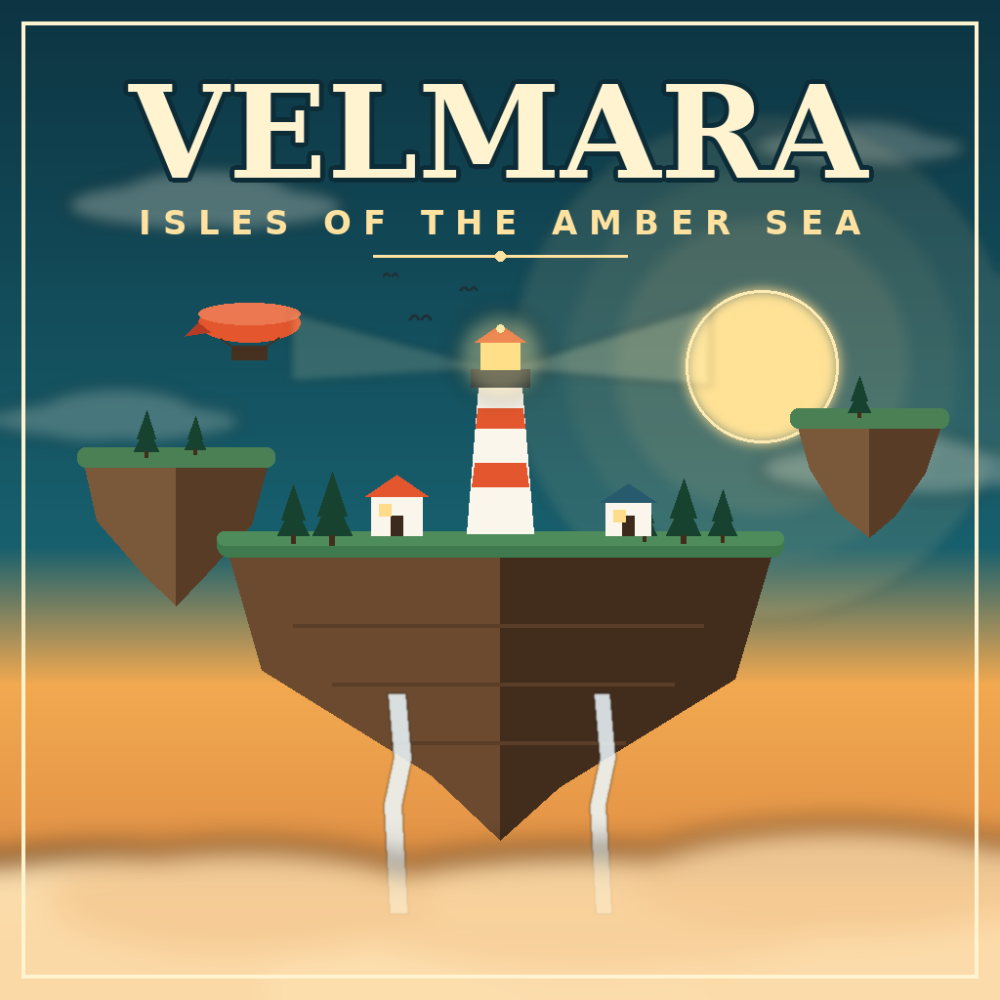

# VELMARA — The Poster for a Place That Isn't There

[](https://make.fun/bounty/the-poster-for-a-place-that-i-2-20261121-0539?utm_source=github&utm_medium=readme&utm_campaign=the-poster-for-a-place-that-i-2-20261121-0539)
[](https://make.fun/bounty/the-poster-for-a-place-that-i-2-20261121-0539/leaderboard?utm_source=github&utm_medium=readme&utm_campaign=the-poster-for-a-place-that-i-2-20261121-0539)
[](https://make.fun/bounty/the-poster-for-a-place-that-i-2-20261121-0539?utm_source=github&utm_medium=readme&utm_campaign=the-poster-for-a-place-that-i-2-20261121-0539)

Entry for the make.fun bounty
[the-poster-for-a-place-that-i-2-20261121-0539](https://make.fun/bounty/the-poster-for-a-place-that-i-2-20261121-0539)
— a travel poster for a place that does not exist
($50, 20 places, deadline Sat 21 Nov 2026 15:39 WIB).



## The place

**VELMARA — Isles of the Amber Sea.** A chain of islands that float
above a sea of clouds, where the sun never quite sets and every evening
is amber. The one landmark: a red-banded lighthouse on the main isle,
its beam sweeping the golden haze while waterfalls spill off the rock
into the clouds below. You get there by airship; you stay for the light.

## Why this poster (mapped to the judge's published criteria, in order)

1. **It is a travel poster for a place that does not exist, with the
   invented place's name set into the picture.** "VELMARA" in large serif
   capitals across the top, with "ISLES OF THE AMBER SEA" beneath it.
   No real destination, no borrowed poster — the floating isles, the
   lighthouse and the amber cloud-sea belong to Velmara alone. No invented
   quotes, no star ratings, no other copy.
2. **It makes you want to go.** Golden-hour weather, a low amber sun, warm
   light on the clouds: one clear promise of what a stay feels like —
   slow evenings above the clouds, watching the lighthouse beam.
3. **A distinct identity.** The name, the landmark and the atmosphere are
   specific to this poster: floating islands with waterfalls falling into
   cloud, a red-banded lighthouse, an airship crossing a teal-to-amber
   sky. Nothing here is a real place with the name swapped.
4. **Type set with intent.** The name is the biggest element on the
   poster, cream serif with a dark outline, centred over the sky and
   carrying the poster's warm mood; the letterspaced subtitle and gold
   rule sit directly under it, part of the composition, not added on.
5. **Colour and composition sell the place.** A purposeful teal-to-amber
   palette leads the eye from the name at the top, down past the airship
   and birds, to the lighthouse — the landmark — and on to the amber
   horizon and the cloud sea at the bottom. A thin cream frame finishes
   the poster.

The image is drawn entirely in code (Pillow, `work/build_poster.py`) —
original art, no photos, no copied artwork, no real logos.

## How it runs

`main.ts` (Node 22, standard library only, no network) copies `entry.png`
to `$MAKEFUN_OUTPUT_DIR/entry.png` (default `/output`), verifies the copy
byte-for-byte (SHA-256), checks the PNG signature, and enforces the
competition's own gates at runtime (whole PNG, at most 1,048,576 bytes,
at most 1024×1024). Two runs produce identical bytes
(1024×1024, 161,092 bytes,
sha256 `a07b021be6a60d8cb0483b3d228acd81ac30297cb9d2e5881ec4f56d064b717c`).

```sh
node main.ts
```

Referral code: `bj2pae9c` — join make.fun with it and we both get a bonus.
